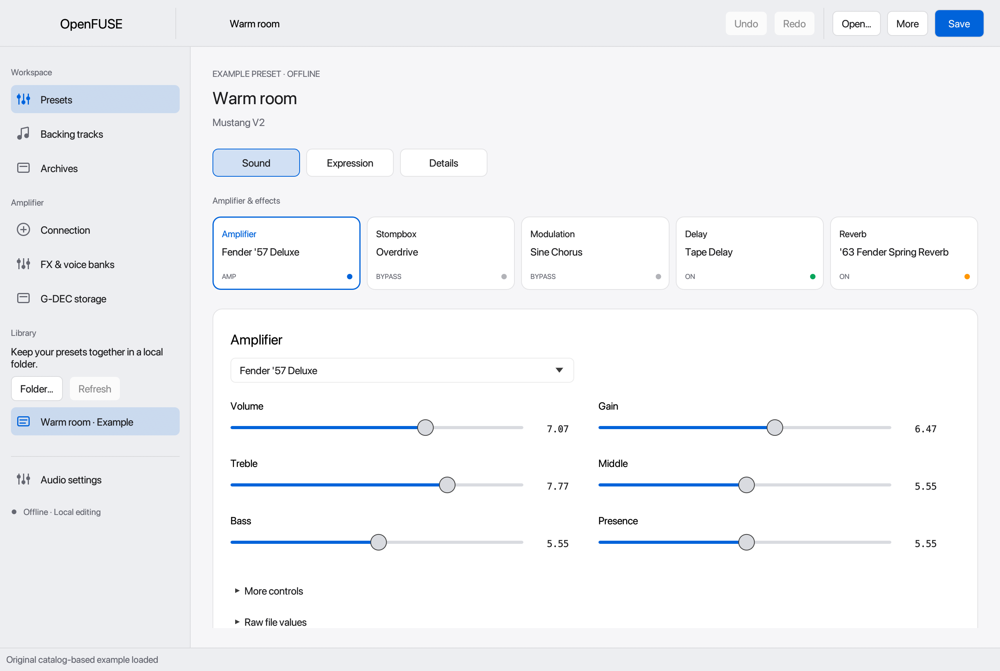
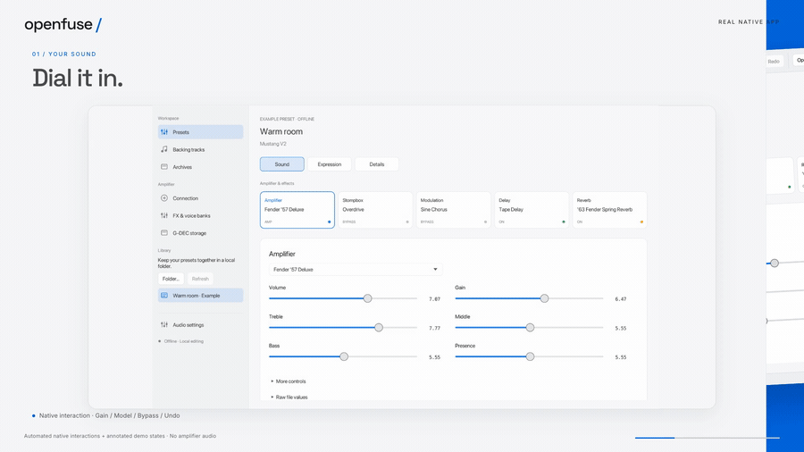
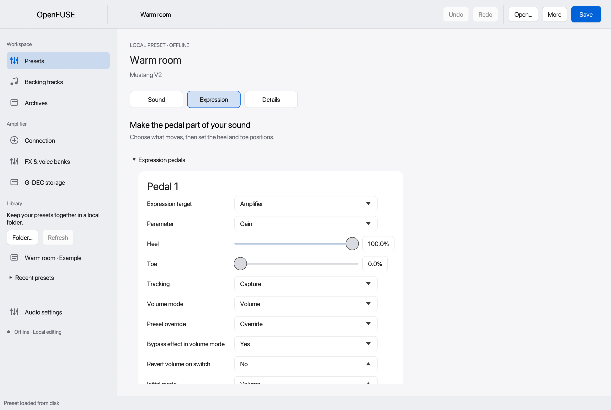
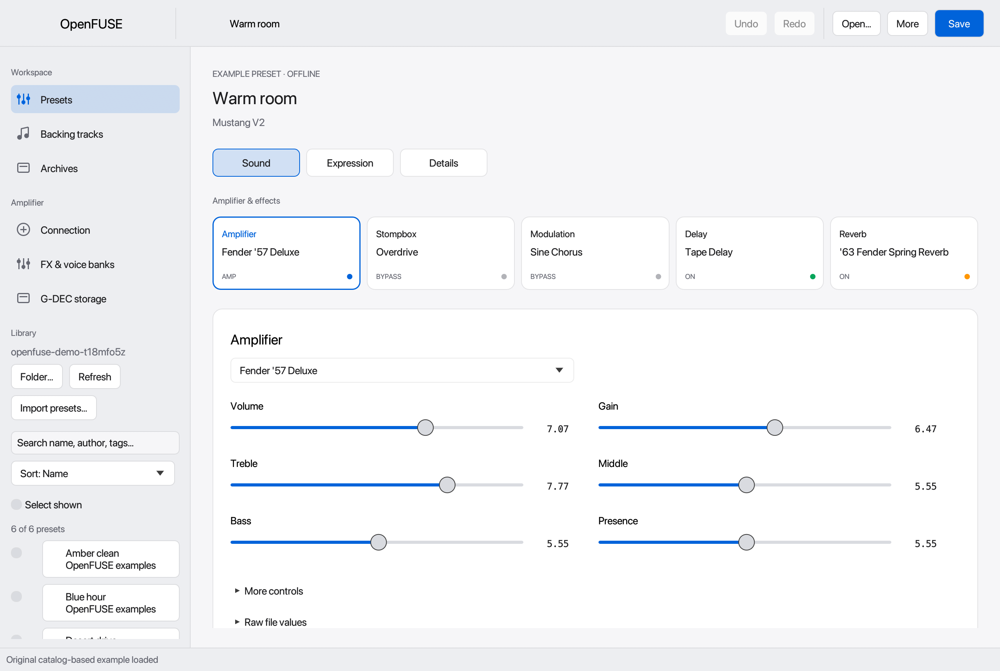
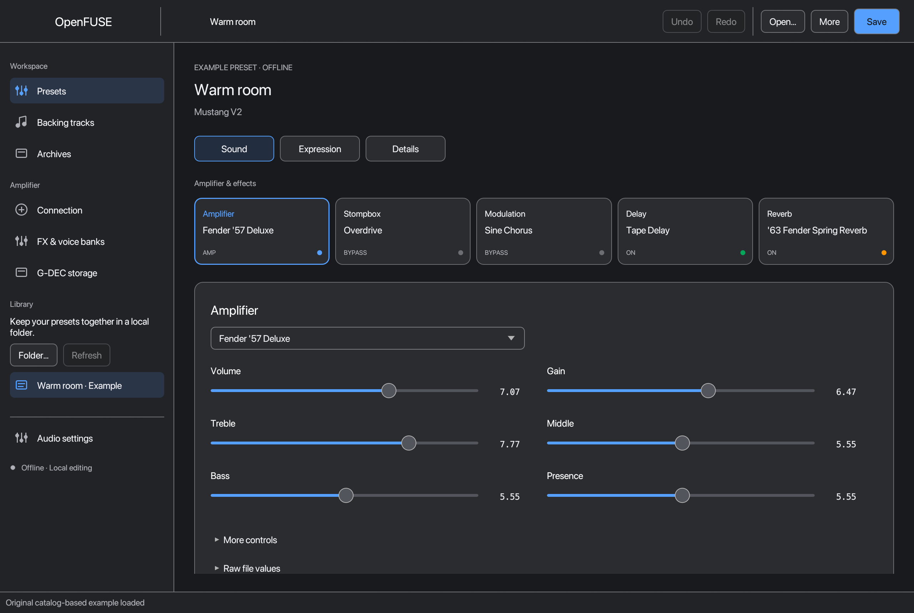
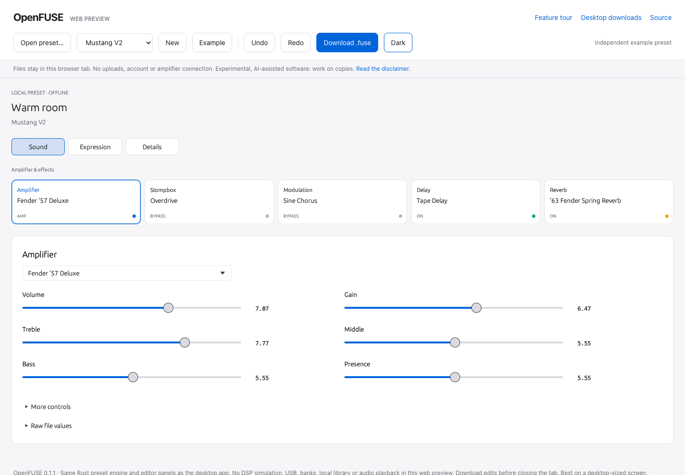

# OpenFUSE

[](#status)
[](Cargo.toml)
[](https://github.com/dbarbashov/openfuse/actions/workflows/rust.yml)
[](LICENSE)

**A native Rust editor for the amplifiers you still want to play.**

Open, edit and organize legacy Fender FUSE presets. Keep your collection on your
computer and work offline, without Silverlight, Mono or a Fender account.

[Download v0.1.1](https://github.com/dbarbashov/openfuse/releases/tag/v0.1.1) ·
[Try the web editor](https://dbarbashov.github.io/openfuse/app/) ·
[Watch the feature tour](https://dbarbashov.github.io/openfuse/) ·
[User guide](docs/usage.md) · [Build from source](#build-from-source)



> [!WARNING]
> **Experimental, AI-assisted software — use at your own risk.** Substantial parts
> were developed with coding agents (“vibe-coded”). This is not an audited or
> production-ready product. No amplifier model is hardware-validated by this
> release. Work on copies and keep an independent backup before device writes.
> Read the [full disclaimer](DISCLAIMER.md).

## See it in action

[](https://github.com/dbarbashov/openfuse/releases/download/v0.1.0/openfuse-demo.mp4)

**[30-second feature tour](https://dbarbashov.github.io/openfuse/)** ·
[Download the MP4](https://github.com/dbarbashov/openfuse/releases/download/v0.1.0/openfuse-demo.mp4)

Real native interactions show parameter editing, model selection, bypass, undo,
library search and expression ranges. USB scenes use a simulator. The original
editorial soundtrack is not amplifier audio.

## Features

- **Preset editor:** amplifier and effect models, model-aware parameters, chain
  arrangement, bypass and undo/redo. Sound, Expression and Details inspectors.
- **Preset preservation:** XML import/export, unknown-field retention where
  supported, metadata, colors and local preset collections.
- **Expression controls:** parameter assignments, heel/toe ranges and selective
  module import with a compatibility preview.
- **Backups and banks:** historical backup-folder import, selected-slot mapping,
  FX/VOICE bank editing and explicit-root G-DEC file tools.
- **Experimental device workspace:** reads, temporary audition, live parameters,
  tuner, stored-preset saves and bank restore with explicit confirmation.
- **Practice tools:** local WAV/MP3 playback, preset track links and audio-output
  selection, sample rate and buffer controls.
- **Appearance:** System, Light and Dark themes in a native Rust/egui application.

| Expression assignments | Local preset library |
| --- | --- |
|  |  |

| Light appearance | Dark appearance |
| --- | --- |
|  |  |

## Download and install

The [v0.1.1 prerelease](https://github.com/dbarbashov/openfuse/releases/tag/v0.1.1)
includes the native editor and CLI for all three desktop platforms:

| Platform | Download | Requirements |
| --- | --- | --- |
| macOS Universal | [DMG](https://github.com/dbarbashov/openfuse/releases/download/v0.1.1/openfuse-0.1.1-universal-apple-darwin.dmg) | Intel or Apple Silicon, macOS 11+ |
| Windows x64 | [ZIP](https://github.com/dbarbashov/openfuse/releases/download/v0.1.1/openfuse-0.1.1-x86_64-pc-windows-msvc.zip) | Windows 10/11, x64 |
| Linux x64 | [tar.gz](https://github.com/dbarbashov/openfuse/releases/download/v0.1.1/openfuse-0.1.1-x86_64-unknown-linux-gnu.tar.gz) | Ubuntu 22.04+ or compatible glibc system, X11/Wayland and OpenGL |
| Browser | [Open web editor](https://dbarbashov.github.io/openfuse/app/) | WebAssembly and WebGL; desktop browser recommended |

**macOS:** open the DMG and copy OpenFUSE.app to Applications. The app is ad-hoc
signed, **not notarized or Developer ID signed**. Use the normal Privacy &
Security / Open Anyway flow only if you trust the source; do not disable
Gatekeeper globally.

**Windows:** extract the ZIP, then open `bin/openfuse-desktop.exe`. The build is
unsigned and Windows may show a reputation warning. The Visual C++ runtime may
be required. **Linux:** extract the archive and run `bin/openfuse-desktop`.
Install `libasound2`, `libudev1`, and `libxkbcommon0` if missing. This is a native
glibc package, not an AppImage. See [installation details](packaging/README.md).

The release also includes SHA256 checksums, platform build manifests and a source
archive with vendored Rust dependencies. CI build/package checks do not establish
physical amplifier compatibility.

### Web editor

[](https://dbarbashov.github.io/openfuse/app/)

[Launch OpenFUSE in your browser](https://dbarbashov.github.io/openfuse/app/).
The web preview uses the **same Rust preset engine and editor panels** as the
native application: amplifier/effect controls, Sound, Expression and Details,
undo/redo, seven preset families, XML import and `.fuse` downloads. Files stay in
the browser tab and are not uploaded. Download your edits before closing it.

USB, device banks, local libraries and audio playback remain desktop features.
The web editor does not simulate amplifier audio. See [web build instructions](web/README.md).

## Build from source

Requires Rust 1.89+ and native platform build tools. On Debian/Ubuntu, install
`libasound2-dev`, `libudev-dev`, `pkg-config` and `libxkbcommon-dev`.

```sh
git clone https://github.com/dbarbashov/openfuse.git
cd openfuse
cargo run --release --locked -p openfuse-desktop
```

Enable experimental USB HID access explicitly:

```sh
cargo run --release --locked -p openfuse-desktop --features hid
```

The app starts offline. Enumeration and connection require explicit actions.
For an offline demonstration, append `-- --demo`. Run the CLI with
`cargo run --locked -p openfuse-cli -- --help`.

The release source archive includes Cargo dependencies. From its extracted root:

```sh
cargo build --offline --locked --release -p openfuse-desktop --features hid
```

## Status

The editor contains catalogs for G-DEC 3, Mustang V1, Mustang V2, Mustang Floor,
Bronco, Super Champ X2 and Passport Mini preset families. Catalog coverage and
USB identity recognition do **not** establish hardware compatibility.

Automated tests and simulator checks cover many editing and protocol paths.
Physical reads, sound, reconnect, persistent writes and restore still need
exact-model/firmware validation. Firmware updates/recovery, phrase sampling,
G-DEC mode/mount automation, full accessibility/localization and discontinued
community services remain outside this preview's complete support.

OpenFUSE edits device presets; it does not emulate the amplifier's DSP.

## Contributing

Bug reports and focused fixes are welcome. Include the version, OS, exact device
and firmware when relevant, and a minimal synthetic or redacted example.
See [CONTRIBUTING.md](CONTRIBUTING.md). Report vulnerabilities through
[private reporting](https://github.com/dbarbashov/openfuse/security/advisories/new).

## License

Original OpenFUSE code is [MIT licensed](LICENSE). Dependencies and fonts retain
[their own licenses](THIRD_PARTY.md). No Fender source code, decompiled source,
installers, assemblies, firmware, artwork or preset collections are distributed.

This independent project is not affiliated with or endorsed by Fender. Product
names identify compatibility targets. OpenFUSE is not represented as a
clean-room implementation. See [DISCLAIMER.md](DISCLAIMER.md).
